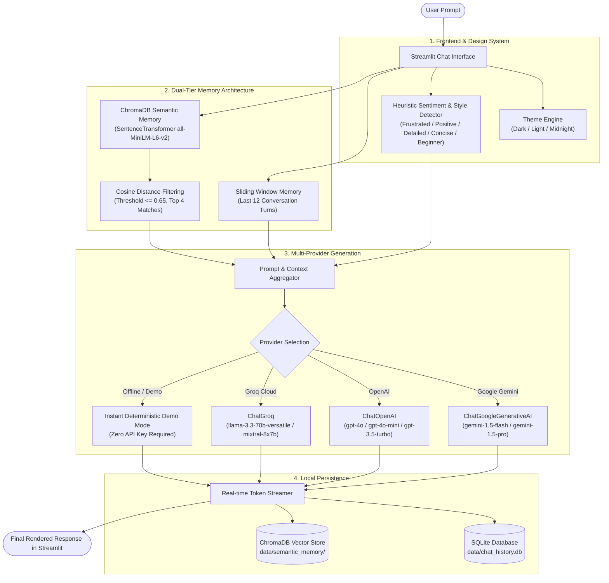

# ✦ Datheon Testing AI — Adaptive Conversational Workspace

[](https://www.python.org/)
[](https://streamlit.io/)
[](https://python.langchain.com/)
[](https://www.trychroma.com/)
[](LICENSE)

> **Datheon Testing AI** is a conversational AI workspace featuring **progressive token streaming**, **multi-provider LLM support** (Google Gemini, OpenAI, Groq) with an instant **zero-key Demo Mode**, **SQLite conversation history**, and a **dual-tier memory system** combining sliding-window recent context with **local semantic long-term retrieval** via ChromaDB and Sentence Transformers.

---

## 🏗️ System Architecture & Workflow



---

## ✨ Key Features

| Feature | Description |
| :--- | :--- |
| **Multi-Provider LLM Integration** | Seamlessly switch between **Google Gemini**, **OpenAI**, and ultra-fast **Groq** models directly from the sidebar. |
| **Instant Demo Mode (Zero Key Required)** | Test the full interface, styling, and memory workflows immediately without entering an API key. |
| **Bespoke Theme Engine** | 3 handcrafted themes (**Dark**, **Light**, and **Midnight**) with custom CSS gradients, Manrope typography, and responsive chat bubbles. |
| **Sliding Window Recent Memory** | Retains the last 12 messages in active LLM context to preserve continuity while minimizing token consumption. |
| **Local Semantic Memory (ChromaDB)** | Embeds messages locally with `sentence-transformers/all-MiniLM-L6-v2`. Retrieves up to 4 semantically relevant older messages from the same conversation. |
| **Zero Third-Party Embedding Leakage** | All text embeddings are generated locally on your CPU/GPU; no chat history is transmitted to third-party embedding APIs. |
| **Heuristic Tone & Style Adaptation** | Detects user sentiment signals (positive, frustrated, neutral) and style preferences (detailed, concise, example-driven) to subtly guide model responses. |
| **Full SQLite Persistence** | Local SQLite database stores conversations with full search, rename, per-chat delete, and bulk wipe controls. |
| **Progressive Token Streaming** | Generates real-time typewriter output using LangChain streaming callbacks for maximum responsiveness. |

---

## 📂 Project Structure

```text
Datheon_Testing_AI/
├── .streamlit/
│   └── config.toml          # Streamlit server & UI configuration
├── data/                    # Local persistent storage (auto-created)
│   ├── chat_history.db      # SQLite database storing conversations & messages
│   └── semantic_memory/     # ChromaDB vector collection files
├── app.py                   # Main Streamlit application & chat controller
├── memory_store.py          # ChromaDB + Sentence-Transformers semantic retrieval
├── requirements.txt         # Production dependencies
├── run_windows.bat          # 1-Click launcher for Windows
├── run_mac_linux.sh         # 1-Click launcher for macOS & Linux
├── .env.example             # Template for API credentials
└── README.md                # Project documentation
```

---

## 🛠️ Prerequisites & Tech Stack

- **Python**: 3.10, 3.11, or 3.12 (Python 3.11 recommended)
- **Framework**: Streamlit 1.41+
- **Agent/LLM Orchestration**: LangChain Core, LangChain Community
- **LLM SDKs**: `langchain-google-genai`, `langchain-openai`, `langchain-groq`
- **Vector Database**: ChromaDB 0.5+
- **Embeddings**: `sentence-transformers` (`all-MiniLM-L6-v2`)
- **Database**: SQLite3 (Standard Python Library)

---

## 🚀 Quickstart & Installation

### Option A: 1-Click Launchers

- **On Windows**: Double-click `run_windows.bat`
- **On macOS / Linux**: Run `bash run_mac_linux.sh`

### Option B: Manual Setup

1. **Navigate to the project folder**:
   ```bash
   cd Datheon_Testing_AI
   ```

2. **Create and activate a virtual environment**:
   ```bash
   # Windows (PowerShell)
   python -m venv .venv
   .\.venv\Scripts\Activate.ps1

   # macOS / Linux
   python3 -m venv .venv
   source .venv/bin/activate
   ```

3. **Install dependencies**:
   ```bash
   pip install --upgrade pip
   pip install -r requirements.txt
   ```

4. **Configure environment variables (Optional)**:
   Copy `.env.example` to `.env`:
   ```bash
   # Windows
   copy .env.example .env

   # macOS / Linux
   cp .env.example .env
   ```
   Add your API keys (you can also enter them directly in the app sidebar at runtime):
   ```env
   GOOGLE_API_KEY=your_gemini_api_key_here
   OPENAI_API_KEY=your_openai_api_key_here
   GROQ_API_KEY=your_groq_api_key_here
   ```

5. **Start the application**:
   ```bash
   streamlit run app.py
   ```
   The browser will automatically open at `http://localhost:8501`.

---

## 🎮 How to Use & Handle the Project

### 1. Selecting an LLM Provider
- Open the left sidebar.
- Choose your preferred provider under **Model Provider**:
  - **Demo mode (no API key)**: Instant testing without credentials.
  - **Google Gemini**: Models like `gemini-1.5-flash` or `gemini-1.5-pro`.
  - **OpenAI**: Models like `gpt-4o` or `gpt-4o-mini`.
  - **Groq**: Ultra-fast inference with `llama-3.3-70b-versatile`.
- Paste your API key into the secure password field if not configured in `.env`.

### 2. Switching Interface Themes
- Use the **Interface theme** dropdown at the top of the sidebar to cycle between **Dark**, **Light**, and **Midnight** aesthetics.

### 3. Managing Chat Sessions
- **Start New Chat**: Click `＋ New conversation`.
- **Search History**: Type keywords into the `Search chat history` field to filter prior threads.
- **Rename Chat**: Click the edit pencil icon next to any chat thread.
- **Delete Chat**: Click the trash icon to remove a specific conversation.
- **Wipe All**: Use `Delete all chats` in the footer to purge the SQLite database.

### 4. Exploring the Dual Memory System
- **Sliding Context**: The app passes the last 12 messages from the active session into the prompt.
- **Semantic Long-Term Memory**:
  - Check the **Use semantic memory** toggle in the sidebar.
  - On the first message, `all-MiniLM-L6-v2` is downloaded to local cache.
  - When you ask a question referencing an older topic discussed earlier in the chat, the system semantically queries ChromaDB and injects up to 4 historical turns into the LLM prompt.
  - View retrieved memories under the **Retrieved Memories** expander below the response.

---

## ☁️ Deployment Guide (Streamlit Community Cloud)

You can deploy this application for free on **Streamlit Community Cloud** with zero DevOps overhead:

1. **Push your code to GitHub** (see the root monorepo guide).
2. Go to [share.streamlit.io](https://share.streamlit.io/) and log in with GitHub.
3. Click **Create app** -> **I already have an app**.
4. Configure the deployment settings:
   - **Repository**: `your-username/your-repository-name`
   - **Branch**: `main`
   - **Main file path**: `Datheon_Testing_AI/app.py`
5. **Set Secrets (Optional)**:
   - Click **Advanced settings...** -> **Secrets**.
   - Add your keys in TOML format:
     ```toml
     GOOGLE_API_KEY = "AIzaSy..."
     OPENAI_API_KEY = "sk-..."
     GROQ_API_KEY = "gsk_..."
     ```
6. Click **Deploy!**. Streamlit Cloud will automatically provision a container, install `requirements.txt`, and generate a public HTTPS URL.

---

## 🔧 Troubleshooting & FAQ

- **PyTorch / SentenceTransformers download slow**:
  - The embedding model (~80MB) is downloaded once upon first run. Ensure an active internet connection on the initial execution.
- **SQLite Database Locked**:
  - The application opens connections with `check_same_thread=False` and closes them safely via context managers. If locked, ensure no external tool has `data/chat_history.db` open.
- **ChromaDB C++ Build Tools Error (Windows)**:
  - ChromaDB wheels are pre-built for Windows x64. If pip tries to build from source, upgrade pip first: `python -m pip install --upgrade pip setuptools wheel`.

---

## 📜 License

Distributed under the MIT License. See [LICENSE](LICENSE) for details.
