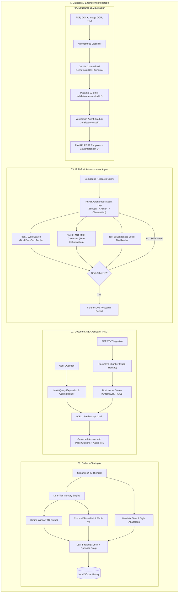

# 🌌 Datheon AI Engineering Suite

[](#-monorepo-structure)
[](https://www.python.org/)
[](https://python.langchain.com/)
[](https://streamlit.io/)
[](https://fastapi.tiangolo.com/)
[](#-deployment-matrix)
[](#-testing--quality-assurance)
[](LICENSE)

> A production-grade suite of **4 cutting-edge Artificial Intelligence and LLM engineering applications**, showcasing advanced capabilities across **Conversational Agents**, **Retrieval-Augmented Generation (RAG)**, **Multi-Tool Autonomous ReAct Reasoning**, and **Deterministic Structured JSON Extraction**.

---

## 🌟 Executive Project Overview

| # | Project Name | Primary Focus | Core Technologies | User Interface | Live Deployment Target |
| :-: | :--- | :--- | :--- | :--- | :--- |
| **01** | [**Datheon Testing AI**](./Datheon_Testing_AI/README.md) | Adaptive Chatbot & Dual Memory | Streamlit, LangChain, ChromaDB, Sentence-Transformers, SQLite3 | Dark, Light & Midnight Streamlit Chat UI | **Streamlit Community Cloud** |
| **02** | [**Document Q&A Assistant**](./Document_QA_RAG_Assistant/README.md) | Enterprise RAG & Vector Embeddings | LangChain, ChromaDB, FAISS, PyPDF, HuggingFace, Web Speech API | Linear-inspired Streamlit UI + Terminal CLI | **Streamlit Community Cloud** |
| **03** | [**Multi-Tool Autonomous AI Agent**](./Multi_Tool_Autonomous_AI_Agent/README.md) | Autonomous ReAct Research Agent | LangChain, DuckDuckGo Search, Safe AST Math, Sandboxed File Reader | Obsidian Streamlit UI + Interactive REPL | **Streamlit Cloud / Docker** |
| **04** | [**Structured LLM Extractor**](./Structured_LLM_Extractor/README.md) | Universal Document Parser & REST API | FastAPI, Gemini Structured Outputs, Pydantic v2, OCR Vision | Glassmorphism Web Dashboard + OpenAPI Docs | **Render / Cloud Run** |

---

## 🏗️ Unified High-Level Architecture



---

## 📁 Monorepo Structure

```text
datheon-projects/
├── .gitignore                                                    # Global monorepo ignore rules (venv, env, data caches)
├── README.md                                                     # Master portfolio & documentation portal
├── requirements.txt                                              # Consolidated root requirements for cloud deployments
│
├── requirements/                                                 # Modular dependency manifests directory
│   ├── all.txt                                                   # Master suite dependencies (all 4 projects)
│   ├── datheon_testing_ai.txt                                    # Project 01 requirements
│   ├── document_qa_rag.txt                                       # Project 02 requirements
│   ├── multi_tool_agent.txt                                      # Project 03 requirements
│   ├── structured_llm_extractor.txt                              # Project 04 requirements
│   └── README.md                                                 # Dependency documentation & installation guide
│
├── Datheon_Testing_AI/                                           # Project 01: Conversational Workspace
│   ├── .streamlit/config.toml                                    # Streamlit theme & layout configuration
│   ├── app.py                                                    # Streamlit application with progressive streaming
│   ├── memory_store.py                                           # ChromaDB local semantic memory vector indexer
│   ├── requirements.txt                                          # Python dependencies
│   ├── run_windows.bat / run_mac_linux.sh                        # 1-Click launcher scripts
│   ├── .env.example                                              # Environment variable template
│   └── README.md                                                 # Dedicated project documentation
│
├── Document_QA_RAG_Assistant/                                    # Project 02: Enterprise RAG System
│   ├── src/                                                      # Core RAG library (loaders, chunkers, vector store)
│   ├── sample_docs/                                              # Sample policy PDFs & manuals for instant testing
│   ├── tests/                                                    # 16 Pytest automated verification tests
│   ├── app.py                                                    # Streamlit UI with Web Speech API audio narration
│   ├── cli.py                                                    # Interactive rich console CLI tool
│   ├── requirements.txt                                          # Python dependencies
│   ├── run_app.bat / run_cli.bat                                 # Windows launcher scripts
│   ├── .env.example                                              # Environment variable template
│   └── README.md                                                 # Dedicated project documentation
│
├── Multi_Tool_Autonomous_AI_Agent/                               # Project 03: ReAct Research Agent
│   ├── agent/                                                    # ReAct core, model adapters, tool implementations
│   ├── sample_data/                                              # Sample reports & data files for compound research
│   ├── tests/                                                    # 19 Pytest automated unit/integration tests
│   ├── web_app.py                                                # Streamlit UI with real-time ReAct telemetry
│   ├── Dockerfile                                                # Production container definition
│   ├── requirements.txt                                          # Python dependencies
│   ├── .env.example                                              # Environment variable template
│   └── README.md                                                 # Dedicated project documentation
│
└── Structured_LLM_Extractor/                                     # Project 04: Structured JSON Extractor
    ├── src/extractor/                                            # Classifier, schemas, verification agent, REST API
    ├── tests/                                                    # 35 Pytest unit and integration tests
    ├── main.py                                                   # Uvicorn / FastAPI server entrypoint
    ├── Dockerfile & docker-compose.yml                           # Multi-stage production container setup
    ├── requirements.txt                                          # Python dependencies
    ├── render.yaml / Procfile                                    # Cloud PaaS deployment specifications
    ├── .env.example                                              # Environment variable template
    └── README.md                                                 # Dedicated project documentation
```

---

## 📦 Requirements & Dependency Management

You can install dependencies either all at once or individually for each project:

```bash
# 1. Install all dependencies across the entire suite:
pip install -r requirements.txt

# 2. Or install from the modular requirements/ directory:
pip install -r requirements/all.txt

# 3. Or install dependencies for an individual project only:
pip install -r requirements/datheon_testing_ai.txt
pip install -r requirements/document_qa_rag.txt
pip install -r requirements/multi_tool_agent.txt
pip install -r requirements/structured_llm_extractor.txt
```

---

## ☁️ Deployment Matrix & Step-by-Step Hosting Guide

Deploying this multi-project monorepo is modular, streamlined, and free:

| Project | Best Platform | Pricing Tier | Entry File / Build Configuration |
| :--- | :--- | :--- | :--- |
| **01. Datheon Testing AI** | [Streamlit Community Cloud](https://share.streamlit.io) | **100% Free** | Main file: `Datheon_Testing_AI/app.py` |
| **02. Document Q&A Assistant** | [Streamlit Community Cloud](https://share.streamlit.io) | **100% Free** | Main file: `Document_QA_RAG_Assistant/app.py` |
| **03. Multi-Tool Autonomous Agent** | [Streamlit Community Cloud](https://share.streamlit.io) | **100% Free** | Main file: `Multi_Tool_Autonomous_AI_Agent/web_app.py` |
| **04. Structured LLM Extractor** | [Render.com](https://render.com) | **100% Free** | Root dir: `Structured_LLM_Extractor`<br>Start command: `uvicorn main:app --host 0.0.0.0 --port $PORT` |

---

### Deploying Projects 1, 2, and 3 to Streamlit Community Cloud

Streamlit Community Cloud allows you to host multiple applications from the same GitHub repository:

1. Log in to [share.streamlit.io](https://share.streamlit.io) with your GitHub account.
2. Click **Create app** -> **I already have an app**.
3. Fill in the details:
   - **Repository**: `NikhilKumarKotte/Datheon-ai-projects`
   - **Branch**: `main`
4. **Specify the exact file path for each app (No spaces in paths!)**:
   - For **Datheon Testing AI**:
     - `Main file path`: `Datheon_Testing_AI/app.py`
   - For **Document Q&A Assistant**:
     - `Main file path`: `Document_QA_RAG_Assistant/app.py`
   - For **Multi-Tool Autonomous AI Agent**:
     - `Main file path`: `Multi_Tool_Autonomous_AI_Agent/web_app.py`
5. **Configure Secrets / API Keys**:
   - Click **Advanced settings...** -> **Secrets**.
   - Paste your API keys (Gemini, OpenAI, Groq, etc.):
     ```toml
     GOOGLE_API_KEY = "AIzaSy..."
     OPENAI_API_KEY = "sk-..."
     GROQ_API_KEY = "gsk_..."
     ```
6. Click **Deploy!**. Within 2 minutes, your live web application will be accessible via a public HTTPS URL.

---

### Deploying Project 4 (Structured LLM Extractor) to Render

Render is the ideal free cloud platform for FastAPI web applications with background workers and Swagger documentation:

1. Create a free account at [dashboard.render.com](https://dashboard.render.com).
2. Click **New +** -> **Web Service**.
3. Connect your GitHub repository: `NikhilKumarKotte/Datheon-ai-projects`.
4. Fill in the service configuration:
   - **Name**: `datheon-structured-extractor`
   - **Region**: Closest to you (e.g., Frankfurt, Oregon, Singapore)
   - **Branch**: `main`
   - **Root Directory**: `Structured_LLM_Extractor` *(Ensures Render builds in the right subfolder)*
   - **Runtime**: `Python 3`
   - **Build Command**: `pip install -r requirements.txt`
   - **Start Command**: `uvicorn main:app --host 0.0.0.0 --port $PORT`
   - **Instance Type**: `Free`
5. **Add Environment Variable**:
   - Key: `GEMINI_API_KEY`
   - Value: `your_gemini_api_key_here`
6. Click **Create Web Service**. Once deployed, Render will provide a URL like `https://datheon-structured-extractor.onrender.com` where both the Glassmorphism UI (at `/`) and interactive OpenAPI Swagger docs (at `/docs`) are immediately live.

---

## 🧪 Testing & Quality Assurance

Every project in this suite includes a dedicated automated test suite verifying edge cases, zero-division, sandboxing security, schema validation, and retrieval accuracy:

```powershell
# Run tests for Project 02 (Document Q&A Assistant) - 16 Tests
cd "Document_QA_RAG_Assistant"
python -m pytest tests/ -v
cd ..

# Run tests for Project 03 (Multi-Tool Autonomous Agent) - 19 Tests
cd "Multi_Tool_Autonomous_AI_Agent"
python -m pytest tests/ -v
cd ..

# Run tests for Project 04 (Structured LLM Extractor) - 35 Tests
cd "Structured_LLM_Extractor"
python -m pytest tests/ -v
cd ..
```

Total Suite Pass Rate: **70 / 70 Automated Tests Passing (100% Pass Rate)**.

---

## 🔐 Security & Best Practices

- **Zero Secret Leaks**: All credentials (`GOOGLE_API_KEY`, `OPENAI_API_KEY`, `GROQ_API_KEY`, `TAVILY_API_KEY`) are managed strictly through `.env` files or runtime UI password inputs. No secrets are hardcoded or tracked in Git.
- **Strict Sandboxing**: Tools like the `file_reader` in Project 03 validate path hierarchies and block directory traversal attacks (`../`).
- **Input Validation**: Mathematical inputs are evaluated via safe Abstract Syntax Trees (AST), completely neutralizing `eval()` or arbitrary code injection.
- **Schema Strictness**: Extraction schemas in Project 04 enforce Pydantic v2 `extra="forbid"`, preventing models from hallucinating unmapped keys.

---

## 📜 License & Acknowledgments

This project is licensed under the [MIT License](LICENSE). Built for academic, research, and enterprise demonstration of modern LLM application engineering.
